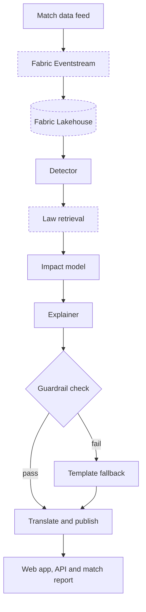

# Decision Intelligence

**Explainable officiating insight for football.** Decision Intelligence finds the contested moments in a match, explains what the Laws say about them, estimates how much each decision mattered, and tells fans and broadcasters in plain language, in their own language.

Built for the **Microsoft x Premier League "Inside the Game: Developer Hackathon"**.

> **Team:** [team name] · **Demo video:** [link] · **Live demo:** [link]

---

## The problem

Officiating decisions shape results, and fans rarely understand them in the moment. Offside margins are measured in centimetres, penalty and red-card calls turn on judgement, and the VAR threshold ("clear and obvious error") is hard to see from the stands or the sofa.

The league is moving toward more openness. From 2026/27 it will publish the findings of its independent Key Match Incidents (KMI) panel, and VAR will be able to review a second yellow card that leads to a red. Reported KMI data shows VAR errors of 38, 31, 18 and 25 across the 2022-23 to 2025-26 seasons. But published findings arrive after the final whistle, and VAR audio is not shared. There is still a gap between what happened and what a fan can understand while watching.

Decision Intelligence fills that gap with an explanation layer that is **grounded, cited and neutral**. It explains decisions. It does not accuse officials.

## What it does

For every contested moment, it answers three questions:

1. **What happened?** Evidence from the event and tracking data, cited by event ID.
2. **What do the Laws say?** The relevant Law and VAR protocol, in plain language.
3. **How much did it matter?** An estimated swing in expected points compared with the alternative decision.

It also says when a call is **too close to call**, so the data is never presented as more certain than it is.

### Incident types covered

| Incident | What the system checks | Law |
|---|---|---|
| Goal checked for offside | Measured margin between attacker and last defender, with a tolerance band | Law 11 |
| Possible missed penalty | Contact severity inside the penalty area against the on-field call | Law 12 |
| Penalty on light contact | Contact rated low where a penalty was given | Law 12 |
| Second yellow checked | Severity of the foul behind a second caution | Law 12 |

## How it works

Dashed boxes are planned Azure integrations. Solid boxes work today in the local build.

### The guardrail

Explanations are only published if they pass a check. A model-written explanation is accepted only if it **cites the real evidence IDs** and **adds no numbers that were not in the supplied facts**. Otherwise the system falls back to a deterministic template, so a fan never sees an unsupported claim.

### Two modes

- **Live:** events stream in and a flagged moment can reach a studio or broadcast screen within seconds, for a person to approve.
- **Post-match:** every incident is collected into a recap, in several languages, in the style of a KMI review.

## Azure services

| Service | Role | Status |
|---|---|---|
| Microsoft Foundry / Azure OpenAI | Explainer agent and evaluations | Optional hook working, hosted agent planned |
| Azure AI Translator | Multilingual output | Working when a key is set |
| Microsoft Fabric (Eventstream, Lakehouse) | Live ingestion and storage | Planned |
| Azure AI Search | Retrieval over the Laws of the Game and league guidance | Planned |
| Azure AI Speech | Spoken recaps | Planned |
| Azure Container Apps | Hosting the API and UI | Planned |
| GitHub and GitHub Copilot | Development workflow | In use |

## How it fits the hackathon brief

| Brief theme | How Decision Intelligence addresses it |
|---|---|
| Analyze match events in real time | Detector runs over the event stream and flags contested moments |
| Explain key moments | Law-grounded, cited explanation for every flagged moment |
| Generate recaps | Post-match incident report, KMI-style |
| Expand datasets | Synthetic incident generator with labelled decisions for testing |
| Multilingual delivery | Translator integration, six languages in the UI |
| Personalized experiences | Separate studio and fan views (planned) |

## Status

| Area | State |
|---|---|
| Synthetic match generator with planted incidents | Working |
| Detector (4 incident types, tolerance band) | Working, thresholds are placeholders |
| What-if impact model | Working, parameters are assumptions |
| Grounded explainer with guardrail | Working |
| Azure OpenAI and Translator hooks | Working with keys, otherwise falls back |
| Local API and demo UI | Working |
| Real hackathon dataset adapter | Planned |
| Fabric, AI Search, Speech, Container Apps | Planned |
| Evaluation run and results | Planned |

## Responsible AI and limitations

- **Neutral by design.** The system explains decisions and flags moments for review. It does not name or blame officials and does not claim bias.
- **Human in the loop.** In live use, a person approves what reaches a screen.
- **Uncertainty is shown.** Borderline calls are labelled "too close to call", and confidence is shown as a heuristic.
- **Estimates, not facts.** Impact figures come from a simple Poisson scoring model with assumed rates, an assumed penalty conversion rate, and assumed effects of playing with ten men. They hold all other events fixed.
- **Synthetic data.** The match, teams and players are fictional. No real match data or personal data is used.
- **Placeholder thresholds.** Detector thresholds and confidence scores are not yet calibrated on the real dataset.
- **Law summaries are paraphrases.** They are a stand-in until retrieval over the official text is in place.

## Evaluation plan

- **Detector:** precision and recall against labelled incidents in the synthetic data.
- **Explainer:** groundedness (every claim traceable to an event ID or Law text) and the guardrail's rejection rate.
- **Impact model:** sanity checks, such as a wrongly allowed goal always benefiting the scoring team, plus sensitivity to the assumed parameters.

## Roadmap

1. Adapt the real hackathon dataset to the event schema and calibrate thresholds.
2. Retrieve Law and guidance text from Azure AI Search.
3. Stream events through Fabric Eventstream and store incidents in a Lakehouse.
4. Host the explainer as a Foundry agent with evaluation runs.
5. Add spoken recaps with Azure AI Speech.
6. Add studio and fan views, and deploy to Azure Container Apps.

## Sources

- Premier League, "What's new in 2026/27 Laws of the Game": https://www.premierleague.com/en/news/4688755/whats-new-in-202627-laws-of-the-game
- KMI panel error counts as reported by BBC Sport for the 2022-23 to 2025-26 seasons.

## License

[Add a license that meets the hackathon rules.]
